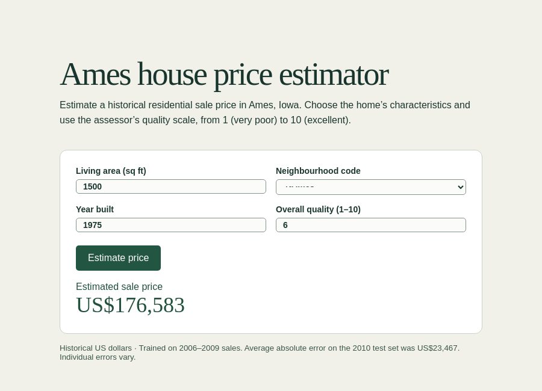

# Ames House Price Prediction

Estimate the historical sale price of a home in Ames, Iowa using its above-ground living area, neighbourhood, construction year and overall quality. The project includes one executed notebook and a local browser app that loads the same fitted scikit-learn pipeline.

**2010 test result:** The model’s estimates differed from recorded prices by **US$23,467 on average** across 341 sales. A baseline that always predicted the development-set median missed by US$52,386 on average.

[Explore the master notebook](ames_house_price_prediction.ipynb)



## Try the app

From a Miniconda prompt with Git installed:

```shell
git clone https://github.com/shainaulakh/ames-house-price-prediction.git
cd ames-house-price-prediction
conda create -n ames-housing python=3.11 -y
conda activate ames-housing
python -m pip install -r requirements.txt
python app.py
```

Open **http://127.0.0.1:8000** if your browser does not open automatically. Click **Estimate price** with the example values below. The fitted model ships with the repository, so the demo can run offline after installation. Stop the local server with **Ctrl+C**.

| Living area | Neighbourhood | Year built | Overall quality | Example prediction |
|---:|---|---:|---:|---:|
| 1,500 sq ft | NAmes (North Ames) | 1975 | 6 of 10 | US$176,583 |

## Six parts, one notebook

| Part | Work completed |
|---|---|
| 1. Define the problem | Read 2,930 sales and 82 columns. Identify the target, final sale price in historical USD. |
| 2. Explore | Reserve 2010. Explore distributions, missing data and unusual sales in 2006–2009. |
| 3. Prepare features | Fit median and most-frequent imputers and a neighbourhood one-hot encoder using earlier sales. |
| 4. Compare models | Compare a median baseline with three-feature linear regression on 2009 sales. |
| 5. Evaluate | Inspect validation residuals, test the addition of quality, refit the selected pipeline and evaluate the reserved year. |
| 6. Demonstrate | Save and reload the full pipeline, reproduce an example and serve predictions through a local form. |

## Results

The validation comparison trained on **1,941 sales from 2006–2008** and evaluated **648 sales from 2009**. Lower mean absolute error (MAE) determined model selection.

| Validation model | 2009 MAE |
|---|---:|
| Training median | $56,861 |
| Linear regression using area, year built and neighbourhood | $26,372 |
| Linear regression adding overall quality | **$23,272** |

The final model and comparison baseline were refit on all **2,589 sales from 2006–2009**. Results below are from the **341 held-out 2010 sales**.

| Test model | MAE | RMSE | R² |
|---|---:|---:|---:|
| Median baseline | $52,386 | $75,344 | −0.022 |
| Final regression | **$23,467** | **$34,379** | **0.787** |

Half of the final model’s absolute errors were at or below **$16,244**. The larger RMSE reflects the influence of large misses. These dollar figures summarize groups of sales. They do not provide a prediction interval for a particular house.

## Reproduce the analysis

In the repository root, download the CSV. On Windows:

```powershell
New-Item -ItemType Directory -Force data
curl.exe -fL https://www.openintro.org/data/csv/ames.csv -o data/ames.csv
```

On macOS or Linux:

```sh
mkdir -p data
curl -fL https://www.openintro.org/data/csv/ames.csv -o data/ames.csv
```

In VS Code, open the master notebook, select the **ames-housing** kernel and choose **Run All**. The final cell rebuilds `model/ames.joblib`. Restart the app to load the rebuilt model. The source CSV used for the published run had SHA-256 `cce822e6d71812f6edcf9d34bf42a2d65b927702c99ac4e6bcf20e5759d7be11`.

## Data and limitations

Dean De Cock documented residential sales from the Ames Assessor’s Office for 2006–2010. OpenIntro distributes the teaching CSV used here. The repository links to the source for download and attribution. Consult the source terms before redistributing the data. [OpenIntro data and variable descriptions](https://www.openintro.org/data/index.php?data=ames) · [Original study](https://doi.org/10.1080/10691898.2011.11889627)

The model learns historical associations in one city. Quality ratings involve judgement, neighbourhood codes proxy local market conditions, and the model omits renovations, sale terms and many property details. Large or unusual homes can be especially difficult to price. The form accepts observed neighbourhoods and numeric ranges, but some combinations within those ranges may still be rare. The intended use is education and demonstration. A contemporary appraisal would require current comparable sales and independent validation.
